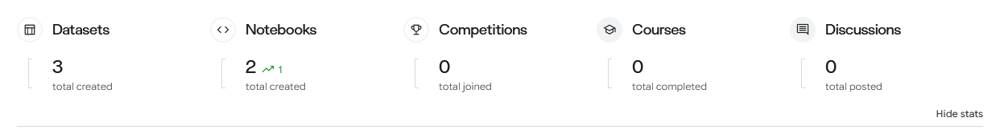

# Générer une interface web (UI)

Short intro\
la partie serveur (intéraction) n'est pas couverte car maîtrisée.

## Cas d'usage

- outil : Google Search / mode IA (**Gemini 3.5 Flash** au moment de la recherche)
- date : 01/11/2026

## Méthodologie

Dans un premier temps, il a été demandé de générer le code HTML / CSS à partir de l'image.

- 1er constat, dans sa réponse, Gemini indique que l'image correspond à un design inspiré de la plateforme Kaggle ! Après vérification, je n'ai trouvé aucune référence à la source dans le fichier de la capture d'écran.

- deux blocs de code HTML et CSS sont générés ; le HTML contient une page web complète.

Le bloc ayant vocation à être intégré dans une application web développée avec R / Shiny, une seconde étape a consisté à demander la traduction du code HTML (dans une application R / Shiny, le HTML est généré dynamiquement à l'aide de fonctions de la librairie Shiny).

- la réponse est parfaitement fonctionnelle sur le plan du code ; quand on lance l'application, l'interface utilisateur contient bien le résultat attendu.

- en revanche, le code n'est pas optimisé. Les cinq indicateurs tels que visibles sur la capture d'écran ont des structures absolument identiques. La bonne pratique dans ces conditions est de définir une fonction unique pour générer cette structure, puis de l'appeler autant de fois que nécéssaire, avec deux avantages : garantir l'homogénéité des résultats, la maintenabilité dans le temps et bien sûr optimiser la taille (poids) du code.

- le design est globalement bien respecté, à l'exception de l'élément graphique côté gauche (en forme de crochet devenu une ligne simple) et le lien pour masquer

### Optimisation

Le code fait environ 80 lignes\
\>\> moins de 20 lignes après optimisation?

### Intégration

L'ingrétion du code généré s'est traduite par un résultat où la structure de l'application était totalement cassée (position de la barre de navigation, thème sombre, partage des espaces).

En cause, la remise à plat de paramètre généraux dans le code CSS, qu'il a fallu supprimer.

De même, les couleurs sont défnies de façon un peu trop statiques sur chaque élément, ce qui ne permet pas de les modifier aisément ni l'adaptation automatique aux modes clair / sombre. Il a fallu les supprimer ou les remplacer par des variables issues de Boostrap.

### Résultat

\>\> capture

## Conclusion

L'utilisation d'un outil IA a sans aucun doute permis de gagner un temps précieux dans la compréhension du mécanisme permettant la création d'un composant contenant des éléments positionnés.

Plus value également avec l'adaptabilité en fonction du support déjà intégrée dans le code CSS (responsive).

En revanche, le manque d'optimisation du code généré suggère qu'il faudrait beaucoup détailler la demande, ce qui reviendrait à transférer du temps sur la rédaction du prompt pour une plus value modérée.

::: callout-tip
Une approche plus intéressante serait de chercher à générer uniquement la fonction permettant de produire le composant ainsi que les classes CSS et d'écrire soi-même les appels à cette fonction pour garantir la structure du code.
:::

## Références

- Code généré (en annexe)
